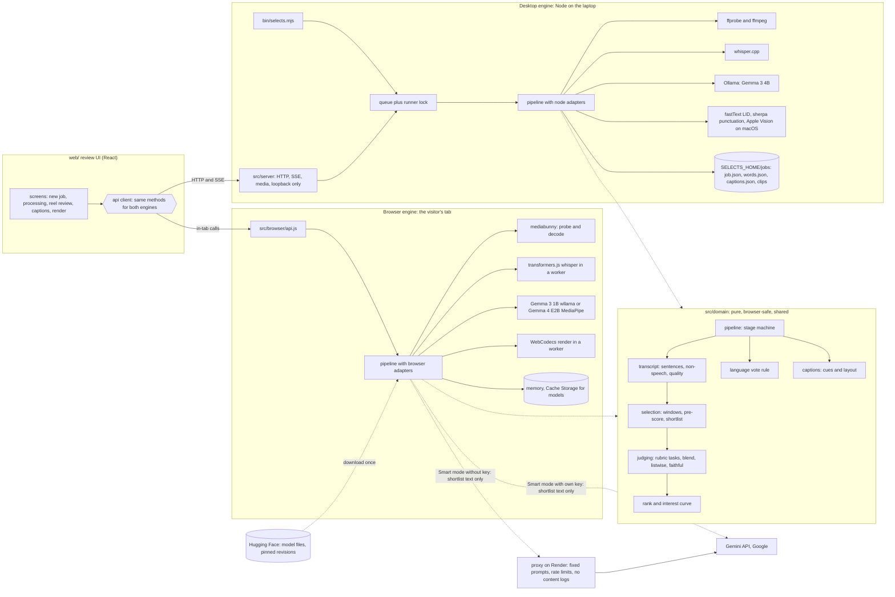
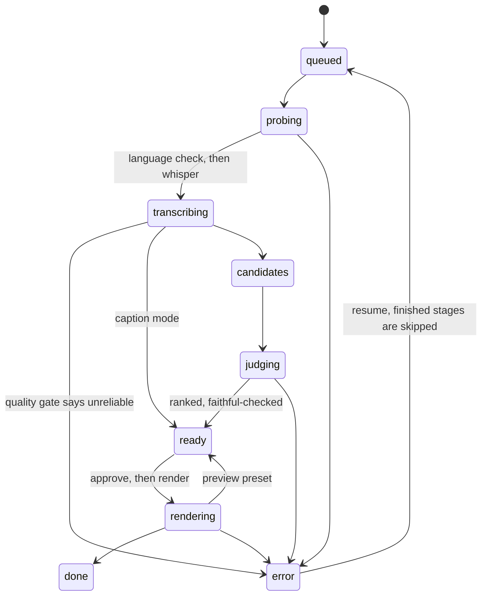

# Selects: architecture review

Independent review, 16 Oct 2026, about 19:50 WAT. HEAD `87d1319` plus the working tree at that time. Three builders were still changing `src/core/job.mjs`, `src/browser/` (untracked) and `web/`, so line numbers in those files may drift by a few lines. Everything else is cited exactly. `npm test`: 179 tests, all pass, 27 s, no models needed.

## Executive summary

**Grade: B.** The core is better than most hackathon code and close to good open-source code. Launch blockers are mostly hygiene and trust, plus one structural risk.

**Three biggest risks**
1. **The pipeline is orchestrated in four places**, and the copies already disagree: `src/core/job.mjs` (desktop), `src/browser/engine.js` (browser), `eval/run-eval.mjs` (eval) and `web/src/mock/server.js` (mock). The eval scores a different pre-score than the one that ships. The browser ignores edited captions in posting kits. The two engines handle failures differently.
2. **Trust gaps in a public repo that promises privacy.** Defaults hard-code `/Users/mac/...`. The local server never checks the Host header, so DNS rebinding can reach transcripts and videos. The Smart-mode proxy's per-IP limit can be spoofed. "Nothing uploaded" is wider than what Smart mode actually does.
3. **`job.json` has two writers.** The runner saves a stale in-memory copy every 2 s, and the PATCH handlers save their own copy. Edits made during a render are silently reverted. Cancellation and cross-process locking are not wired up anywhere.

**Three biggest strengths**
1. **A real functional core with an enforced boundary.** `src/core/browser-safe.test.mjs:10-35` fails the build if a pure module pulls in Node. Every expensive stage is injectable (`deps`, `request`), so the whole pipeline is tested without whisper, Ollama or ffmpeg.
2. **Idempotent, checkpointed stages with caches keyed by their inputs.** Whisper output is keyed by its meta (`transcribe.mjs:153-162`), the language decision by its rule version (`language.mjs:108-109`) and judge answers by a prompt hash (`judge.mjs:15-20,147`). Every write is atomic (`util.mjs:49-54`).
3. **Decisions backed by measurements, and errors that say what to do next.** `notes/timings.md` and the "Tried and rejected" table in `notes/MODELS.md` record the evidence. Errors carry a plain `hint` (for example `judge.mjs:107-113`). The dependency tree is lean: 21 packages at the root, and exact pins in `web/` and `src/browser/`.

---

## Findings

### P0: must fix before the public launch on Sunday

#### P0-1. Machine-specific paths in the defaults and in the docs

- **Evidence:** `src/core/config.mjs:8` (`const PIPELINE = "/Users/mac/Documents/DevProjects/road-to-50k/crew/video-weekend/pipeline"`), used at `:12` (whisper-cli) and `:17` (the default model). `modelsDir()` (`:21-23`) derives from it, so on a fresh clone model discovery (`asrModels()`, `languageCheckModel()`, langid, punctuation, the accent model) points into a folder that does not exist. `notes/CONTRACTS.md:5,9,23` expose the private workspace layout and internal process rules ("Do not copy code from `road-to-50k/...`", "Do not push").
- **Why it matters:** the first thing a judge or contributor does is clone and run the project. Every model lookup misses, and the code tells them it was only ever run on one Mac. An absolute personal path in shipped code is also the clearest "not production" signal a hiring manager can find.
- **Fix:** default to a per-user folder and let `selects doctor` explain what is missing.

```js
// config.mjs
const HOME_DEFAULT = path.join(os.homedir(), ".selects");
export const selectsHome = () => process.env.SELECTS_HOME || HOME_DEFAULT;
export const modelsDir = () => process.env.SELECTS_MODELS_DIR || path.join(selectsHome(), "models");
export const whisperModel = () => process.env.SELECTS_WHISPER_MODEL || path.join(modelsDir(), "ggml-base.en.bin");
export const whisperBin = () => process.env.SELECTS_WHISPER_BIN || "whisper-cli";
```

On your own Mac, keep working by putting `SELECTS_WHISPER_BIN` and `SELECTS_MODELS_DIR` in your shell profile. Update the README quickstart so it downloads models into `~/.selects/models`.

#### P0-2. The local server does not check the Host header (DNS rebinding)

- **Evidence:** `src/server/server.mjs:240-251`. `cors()` (`:56-65`) only refuses non-GET requests from foreign origins. Under DNS rebinding, a malicious page's GETs count as same-origin and carry no `Origin` header, so they pass. Reachable GETs: `/api/jobs` (absolute source paths), `/api/jobs/:id/words` and `/captions` (transcripts), `/media/:id/source` (streams the file at any path the job points to, `:414`), and `/api/locate` (walks `~/Movies`, `~/Downloads`, `~/Desktop` and `~/Documents` to confirm a file exists, `:188-224`). Job ids are guessable: `j_YYYYMMDD_<seconds of the day in base 36>` (`job.mjs:50-60`). Binding to 127.0.0.1 (`:455`) does not stop rebinding. Ollama shipped a fix for this exact class of bug in 2024.
- **Why it matters:** "nothing leaves your machine" is the headline. This is the one realistic way it can be broken, and the fix is a few lines.
- **Fix:** reject any request whose Host is not loopback on our port. Send `Cross-Origin-Resource-Policy: same-origin` on `/media/*` so other sites cannot embed it in no-cors mode.

```js
const LOOPBACK = new Set(["127.0.0.1", "localhost", "[::1]"]);
function hostAllowed(req, port) {
  const m = /^(\[[^\]]+\]|[^:]+)(?::(\d+))?$/.exec(String(req.headers.host || ""));
  return !!m && LOOPBACK.has(m[1].toLowerCase()) && Number(m[2] || 80) === port;
}
// first line of route():
if (!hostAllowed(req, req.socket.localPort)) throw new HttpError(421, "This address is not served here.");
```

Add a test that sends `Host: evil.example:4317` and expects 421. While you are in this file, tighten `serveStatic` (`:231-233`): use `file.startsWith(WEB_DIST + path.sep)`, and wrap `decodeURIComponent` in a try so a bad escape returns 400, not 500.

#### P0-3. Lost updates: two writers on job.json

- **Evidence:** `renderClips` loads the job once (`job.mjs:776`) and saves that object on every progress tick and clip (`:800, :811, :834, :840`). It writes kits with `writeKit(job, ...)` (`:826`), using the settings as they were when the render started. Meanwhile `updateJobSettings` (`:675-706`) and `updateCandidate` (`:579-632`) load, change and save their own copy. The UI makes these calls while a render runs: `web/src/components/RenderScreen.jsx:198` (credit and licence) and `:251` (captions on or off). The runner's next save reverts the edit, and the kit is written with the old credit. The same pattern exists during analysis: approvals made while judging are read from the stale copy at `job.mjs:544-546`.
- **Why it matters:** attribution is a rights feature. The PATCH returns 200 and the UI shows the new credit, but the file on disk and the posted caption do not have it. Users will not notice until after they have posted the clip.
- **Fix (small and enough for Sunday):** give each field one owner. The runner owns progress fields. People own settings and decisions. Every write goes through a synchronous load, change and save, which cannot interleave within one Node process.

```js
// job.mjs
export function mutateJob(id, fn) {           // the only way to change job.json
  const job = loadJob(id);
  const out = fn(job) ?? job;
  saveJob(out);
  return out;
}
const RUNNER_FIELDS = ["stage", "stages", "error", "source", "language", "accent", "asr", "punctuation",
  "transcriptQuality", "thumbs", "curve", "timings", "listwise", "faithful", "output"];
const HUMAN_CANDIDATE_FIELDS = ["status", "blur", "start", "end", "text", "hook", "trimmed"];
// in runStages/renderClips, replace saveJob(job) with:
const save = () => mutateJob(id, (disk) => {
  for (const k of RUNNER_FIELDS) if (k in job) disk[k] = job[k];
  const mine = new Map(disk.candidates.map((c) => [c.id, c]));
  disk.candidates = job.candidates.map((c) => ({ ...c, ...pick(mine.get(c.id) ?? {}, HUMAN_CANDIDATE_FIELDS) }));
  Object.assign(job, { settings: disk.settings });   // pick up credit and licence edits mid-render
});
```

`writeKit` must read `loadJob(id).settings` at the moment it writes. Add a test that runs a render with a slow fake `render` dep, sends a credit PATCH halfway through, and asserts that both `job.json` and the kit contain the new credit.

#### P0-4. The Smart-mode proxy trusts a header the client controls

- **Evidence:** `server-proxy/server.mjs:54`. `clientIp` takes the first `X-Forwarded-For` entry, which the client writes. One script that sends a random XFF on each request gets around `perIpPerMinute` and `perIpPerDay` (`:99-106`), uses up `globalPerMinute: 25` for everyone, and drains the project key's daily quota. Requests with no `Origin` header are allowed (`:92`), so curl works. That is acceptable only if the per-IP limits hold. Separately, the body is built by string concatenation per chunk (`:108-116`), which can split a multi-byte UTF-8 character (Yoruba diacritics) at a chunk boundary.
- **Why it matters:** it goes public this weekend, and a quota you cannot defend means Smart mode is down for every visitor.
- **Fix:**

```js
const HOPS = Number(process.env.TRUST_PROXY_HOPS ?? 1);  // Render appends the real client IP last
function clientIp(req) {
  const xs = String(req.headers["x-forwarded-for"] || "").split(",").map((s) => s.trim()).filter(Boolean);
  return (HOPS > 0 && xs.length >= HOPS ? xs[xs.length - HOPS] : null) || req.socket.remoteAddress || "unknown";
}
// body: collect Buffers, then Buffer.concat(chunks).toString("utf8")
```

After deploying, check with `curl -H 'X-Forwarded-For: 1.2.3.4'` that the limiter key does not change. Add a test that spoofs XFF 30 times and expects 429.

#### P0-5. The privacy claims are wider than the data flows

- **Evidence:** `README.md:3` ("with nothing uploaded") and the `package.json` description ("Nothing leaves your machine") are true for the desktop engine only. In Selects Web, Smart mode sends shortlisted transcript text to Google (`src/browser/llm.js` `geminiKeyBackend` and `proxyBackend`, `src/core/gemini.mjs:95`). The proxy uses the project's free-tier key. Under the Gemini API's terms for unpaid services, Google may use submitted content to improve its products, and human reviewers may read it. Private mode also loads MediaPipe's WebAssembly at run time from `cdn.jsdelivr.net` (`src/browser/llm.js:83`) and downloads models from Hugging Face, so visitors' IPs reach both.
- **Why it matters:** a reader who finds one overstated privacy claim stops trusting all the others.
- **Fix:** add a "Where your data goes" table to the README with one row per engine and mode (Desktop, Web Private, Web Smart with your key, Web Smart through the proxy). Columns: what leaves the device, to whom, and whether it may be used for training. Change the tagline to "Desktop: nothing leaves your laptop. Web: private by default." Put the free-tier sentence into `api.copy.smartMode.proxyLine`.

#### P0-6. Internal working notes ship in the public repo

- **Evidence:** `git ls-files notes` lists 81 files and 14 MB. Among them: `notes/CONTRACTS.md` (builder instructions, private paths), `notes/post-draft.md` (`published: false`, the unpublished DEV post), `notes/UX-REVIEW.md`, `notes/DESIGN-DIRECTIONS.md`, `notes/test-media.md`, and 74 screenshots, of which the README uses a handful. `docs/` exists but is empty.
- **Why it matters:** a reader with 10 minutes opens the folders in order. `notes/` reads as a scratchpad and hides the parts that are actually good (MODELS, timings, the contracts).
- **Fix:** keep `docs/` for public material and move private material out of the repo. Details are under "Repo hygiene" below. This takes 45 minutes and only moves files. History keeps the old files, which is fine: they contain no secrets. I checked: `git log -S AIza` finds nothing, and `.env` was never committed.

#### P0-7. No CI, and the deploy builds from untracked code

- **Evidence:** there is no `.github/`. `render.yaml` (committed) builds `src/browser`, which `git status` shows as untracked (`?? src/browser/`). `web/` imports `../../../src/core/...` (`web/src/lib/sentences.js:5`). Nothing proves that a clean clone can install, test and build.
- **Why it matters:** a green CI badge is the cheapest trust signal you can show. It would also have caught P0-1.
- **Fix:** one workflow, about 30 minutes. See "CI plan" under P1-3. Run it on a clean clone before announcing.

---

### P1: this weekend if time allows

#### P1-1. One pipeline, behind ports, shared by both engines (the fork)

- **Evidence of drift, which is already in the code:**
  - The stage machine is defined twice: `job.mjs:37-38` and `engine.js:20-21` (`STAGES`, `STAGE_LABEL`). `freshStage` and `newId` are duplicated. `DEFAULT_SETTINGS` lives at `config.mjs:97` and again at `engine.js:24`. The pure defaults sit in a module that imports `node:fs`, so the browser had to copy them.
  - The judge loop exists twice: `src/core/judge.mjs:135-199` and `src/browser/judge.js:51-133`. They follow different policies. The desktop throws after two bad answers (`judge.mjs:166`), and the whole stage fails. The browser keeps the pre-score and carries on (`judge.js:115,119`). The scoring step is copied as well (`judge.mjs:170-178` and `judge.js:35-39`).
  - `tasks.mjs` (`buildTask` and `readTask`) is the provider-neutral judge interface, but the desktop Ollama path does not use it (`judge.mjs:23-25,140`). There are two abstractions for the same thing.
  - Kits: the desktop uses the edited captions (`job.mjs:640-647`, `kitSource`). The browser does not (`engine.js:569`, `makeKit(c, ...)`). That fix landed in core and never reached the browser.
  - Preview semantics differ. On the desktop a preview leaves the job `ready` (`job.mjs:839`). In the browser any render sets `done` (`engine.js:583`).
  - Trims are implemented twice: `job.mjs:613-623` and `engine.js:465-472`.
  - Faithful cuts went into `job.mjs` this evening, and the browser engine has no equivalent yet.
  - The ASR port exists but nothing calls it. `src/core/asr/index.mjs` defines `asrProvider()`, which is used nowhere. `job.mjs:26` imports `transcribe` directly, and `job.mjs:451` hard-codes `provider: "whisper.cpp"`.
- **Why it matters:** "the desktop and the browser share the same core" is the architectural claim that DEV judges and AI-engineering readers will check first. Today they share the leaf functions but not the policy, and every new feature (faithful cuts is the latest) has to be written twice.
- **Fix:** move the orchestration into a browser-safe `pipeline.mjs` that talks only to ports. Engines become composition roots.

```js
// src/core/ports.d.ts (types only; see P1-3)
export interface LlmPort { id: string; model: string; where: "local" | "device" | "google";
  load?(o: { onProgress?: Fn; onWaking?: Fn }): Promise<void>;
  generate(r: { messages: Msg[]; schema: object; maxTokens: number; signal?: AbortSignal }): Promise<{ data?: unknown; text: string; stats?: object }>; }
export interface AsrPort { id: string; transcribe(input: MediaRef, o: AsrOpts): Promise<{ words: Word[]; events: NonSpeech[]; info: AsrInfo }>; }
export interface MediaPort { probe(i: MediaRef): Promise<Source>; thumbs(i: MediaRef, n: number): Promise<Thumbs>;
  loudness(i: MediaRef): Promise<Loudness | null>; renderClip(job: Job, c: Candidate, o: RenderOpts): Promise<RenderResult>; }
export interface JobStore { load(id: string): Job; mutate(id: string, fn: (j: Job) => Job | void): Job;
  artifact<T>(id: string, name: string, fallback?: T): T; putArtifact(id: string, name: string, v: unknown): void; }
export interface Cache { get(k: string): unknown; set(k: string, v: unknown): void; }
```

```js
// src/core/pipeline.mjs (browser-safe): the stage machine, written once
export async function analyse(id, { store, media, asr, llm, langid, cache, emit, signal, policy }) {
  await stage("probe", ...);  await stage("language", ...);  await stage("transcribe", ...);
  const sel = selectCandidates({ words, events, loudness, settings, duration });      // P1-2
  const judged = await judgeShortlist(sel.shortlist, llm, { cache, signal, policy });  // one loop, one policy
  ...
}
```

The Ollama adapter is about 15 lines: `generate()` wraps today's `ollamaJson`. The browser backends rename `run(task)` to `generate(buildTask(task, PROMPTS))`. `judge.mjs` and `src/browser/judge.js` collapse into `src/core/judging.mjs`. The desktop passes a file cache and the browser passes a `Map`. Decide the failure policy once, in an ADR. I recommend "keep the pre-score and mark `scores: null`" everywhere. Then either wire `asrProvider()` into the pipeline or delete `asr/index.mjs`. A port that nothing calls reads as architecture theatre.

#### P1-2. The eval measures a different shortlist from the one that ships

- **Evidence:** `eval/run-eval.mjs:156` calls `makeCandidates(sentences, { minLen, maxLen })` with no `loudness`, `events` or `words`, without `speechOnly` and without punctuation restore. The shipped pipeline passes all of them (`job.mjs:495`, `engine.js:318`). The loudness envelope is computed afterwards (`run-eval.mjs:160-167`) and only used by the energy baseline. The pre-score and the shortlist the judge sees therefore differ from production.
- **Why it matters:** the eval is the project's main credibility asset in the DEV post. "We measured the shipped pipeline" has to be literally true.
- **Fix:** add one pure `selectCandidates({ words, events, loudness, settings, duration }) -> { sentences, windows, shortlist }` in `src/core/select.mjs`, and call it from `job.mjs`, `engine.js` and `run-eval.mjs`. Re-judging needs Ollama runs, which take hours on this laptop. If those cannot finish before Sunday, add a one-line caveat to `eval/README.md` and RESULTS ("pre-score without the loudness and laughter signals") and re-run overnight.

#### P1-3. Contracts: a machine-checked source of truth without a build step

- **Evidence:** the contracts are prose (`notes/CONTRACTS.md`, about 300 lines, written as dated additive changelogs). There are three implementations of the API and nothing checks that they agree: `src/server/server.mjs`, `src/browser/api.js` and `web/src/mock/server.js` (676 lines). Validation is hand-rolled and scattered (`cleanBlur` at `job.mjs:310`, `checkTaskShape` at `tasks.mjs:117`, inline checks at `server.mjs:349-351`, `SETTABLE` at `job.mjs:669`). There is no `@ts-check` anywhere.
- **Recommendation (the lightest approach that gives real type safety):**
  1. **The types are the source of truth, as JSDoc plus one `.d.ts`.** `src/contracts/types.d.ts` holds `Job`, `Settings`, `StageState`, `Candidate`, `Word`, `Cue`, `JobEvent` (a discriminated union by `type`), `ApiError` and the ports above. Each module adds `// @ts-check` and `/** @import { Job, Candidate } from "../contracts/types" */` (TypeScript 5.5 and later). `tsc --noEmit` reads them. Nothing is compiled.
  2. **Adopt it gradually.** Set `checkJs: false` in `tsconfig.json`, so only files that opt in with `// @ts-check` are checked. Start with the pure core: `sentences`, `candidates`, `rank`, `cues`, `layout`, `judge-core`, `kit-core`, `tasks`, `gemini`, `attribution`, `nonspeech` and `langid/rule`. They are already small and functional.
  3. **JSON Schema only for the wire** (HTTP request bodies, responses and SSE events), in `src/contracts/*.schema.mjs`, as `/** @type {const} */ ({ ... })` objects. If you want the types derived from them, `json-schema-to-ts`'s `FromSchema` works from JSDoc and is a type-only dev dependency. Use Ajv (dev dependency) in a **contract test** that drives the same scenario (create, events, approve, trim, captions edit, render) through all three adapters and validates every response and event. That one test removes drift between the desktop, the browser and the mock.
  4. **Runtime validation at the boundaries** stays hand-written but lives in one module (`src/contracts/validate.mjs`). It is used by the server, the proxy and the browser facade. That way there is no Ajv in the runtime bundle.

```jsonc
// tsconfig.json (dev deps: typescript, @types/node)
{ "compilerOptions": { "allowJs": true, "checkJs": false, "noEmit": true, "strict": true,
    "module": "nodenext", "moduleResolution": "nodenext", "target": "es2022", "skipLibCheck": true,
    "lib": ["es2022", "dom"], "types": ["node"] },
  "include": ["src/contracts", "src/core", "src/server", "server-proxy", "bin"] }
```

**CI plan** (`.github/workflows/ci.yml`; it runs without models, because every expensive path is already a fake in the tests):

```yaml
on: [push, pull_request]
jobs:
  test:
    strategy: { matrix: { os: [ubuntu-latest, macos-latest], node: [20, 22] } }
    runs-on: ${{ matrix.os }}
    steps:
      - uses: actions/checkout@v4
      - uses: actions/setup-node@v4
        with: { node-version: "${{ matrix.node }}", cache: npm }
      - run: npm ci --omit=optional          # no sherpa-onnx; punctuation tests already fake the loader
      - run: npm test
      - run: npx tsc -p tsconfig.json        # once P1-3 lands
      - run: npm --prefix web ci && npm --prefix web run build
      - run: npm --prefix src/browser ci && npm --prefix src/browser run build
```

Add ESLint only for correctness rules (`no-undef`, `no-unused-vars`, `no-unreachable`). Do not add a formatter fight this weekend.

#### P1-4. Job model: cancellation, one runner, and error codes

- **Cancellation is plumbed but unreachable.** `signal` flows through every stage (`job.mjs:325`, `transcribe`, `judge`, `render`, `gemini`), and `fail()` turns an `AbortError` into "Stopped" (`job.mjs:560-572`). But `drainQueue` never creates an `AbortController` (`queue.mjs:56-66`), there is no cancel route in `server.mjs`, and the CLI has no SIGINT handler (`grep SIGINT` finds nothing). **Fix:** the queue keeps `current = { item, ctl: new AbortController() }`. Add `POST /api/jobs/:id/cancel` (it aborts the item if it is running, or removes it from `queue.json`). In the CLI, SIGINT calls abort, then the process exits once the job has saved.
- **heavy.lock is an eval hack. The product needs one runner per `SELECTS_HOME`.** `running` (`job.mjs:39`) and `draining` (`queue.mjs:34`) are per process. `selects serve` and `selects queue run` (or `selects review`) can drain the same `queue.json` and write the same `job.json` at the same time. **Fix:** a lockfile `<home>/runner.lock` created with `fs.openSync(f, "wx")`, holding `{ pid, host, startedAt, port }`. A lock is stale when `process.kill(pid, 0)` throws. While a server holds the lock, the CLI hands work to it over HTTP (`POST /api/jobs`) or says "Selects is already running at http://127.0.0.1:4317". Keep queue concurrency at 1 by default (dual-core), with `SELECTS_CONCURRENCY` for bigger machines.
- **Errors have hints but no codes, and five shapes.** The server sends `{ error, hint }` (`server.mjs:448`). The job stores `{ stage, message, hint, suggest }` (`job.mjs:564-569`). The browser throws objects with `status` and `hint`. The proxy sends `{ error, hint, transient, retrySec }`. The web client then flattens `message + hint` into one string (`web/src/lib/api.js:10`), so the UI cannot branch on the kind of failure. **Fix:** a browser-safe `src/core/errors.mjs`:

```js
export const E = { WHISPER_MISSING: "whisper_missing", MODEL_MISSING: "model_missing", OLLAMA_DOWN: "ollama_down",
  MODEL_NOT_PULLED: "model_not_pulled", NO_SPEECH: "no_speech", TRANSCRIPT_UNRELIABLE: "transcript_unreliable",
  ABORTED: "aborted", RATE_LIMITED: "rate_limited", JOB_BUSY: "job_busy", BAD_REQUEST: "bad_request", NOT_FOUND: "not_found" };
export class SelectsError extends Error {
  constructor(code, message, { hint, status, stage, suggest, transient, cause } = {}) {
    super(message, { cause }); Object.assign(this, { code, hint, status, stage, suggest, transient });
  }
  toJSON() { const { code, message, hint, stage, suggest, transient } = this; return { code, message, hint, stage, suggest, transient }; }
}
```

  Every boundary serialises `toJSON()`. `api.js` keeps `err.code` and `err.hint` as separate fields. Document the codes table in `docs/CONTRACTS.md`.
- **SSE is mostly right.** It sends a snapshot first (`server.mjs:151-164`), then deltas, with `retry: 2000` and a 20 s heartbeat, so a reconnect gets the full job again. Write that rule down as part of the contract ("on `job`, replace your state; on `words` after a reconnect, re-fetch `/words`"). Add an `id:` sequence for debugging. A replay buffer is not needed.

#### P1-5. Config is spread out, and the default home is inside the install

- **Evidence:** about 20 `SELECTS_*` variables are read from 9 modules: `judge.mjs:81` (THREADS), `render.mjs:75,88` (HWACCEL, GPU_SCALE), `transcribe.mjs:105,124` (WHISPER_THREADS, WHISPER_ARGS), `faces.mjs:171`, `punctuate.mjs:14`, `profiles.mjs:3`, `bin/selects.mjs:553`, and more. `selectsHome()` defaults to `<repo>/.selects` (`config.mjs:84-86`). With `npm i -g selects`, that is inside the global `node_modules`, so job data and videos land in the package folder and disappear on upgrade.
- **Fix:** one `config()` in `config.mjs` that reads `process.env` once and returns a frozen object. Every other module imports from it. `selects doctor --json` prints the resolved config and which models were found. The default home is `~/.selects` (P0-1). If `<repo>/.selects` exists, use it once and print a move hint.
- **Cross-platform:** the macOS-only parts are isolated well. Face detection checks `process.platform` and gives a by-hand fallback hint (`faces.mjs:174-186`). VideoToolbox is gated (`render.mjs:74-78`), with `SELECTS_HWACCEL` as an override. Windows gaps (P2): the `npm test` glob relies on the shell (`package.json` scripts), `process.env.HOME` is used where `os.homedir()` belongs (`config.mjs:65`), and `"/"` checks on paths appear in `asr/index.mjs:20`.

#### P1-6. Browser supply chain: pin revisions, verify bytes, self-host code

- **Evidence:** every model URL uses `resolve/main` (`src/browser/models.js:26,39,49`), which is a mutable branch, and nothing checks a hash. `cachedFetch` (`cache.js:25-53`) stores whatever arrives and never compares it with `expectedBytes`. MediaPipe's WebAssembly loader is fetched from jsdelivr at run time (`llm.js:83`), which means third-party code runs with no SRI. `dist-web/_headers` has no CSP, yet the page keeps a Gemini key in `sessionStorage` (`api.js:16`). The desktop has the same gaps: `notes/MODELS.md` records revisions for the langid models (good) but no hashes, and the README `curl`s a GGUF from `resolve/main`.
- **Fix:** one `models.lock.json` shared by both engines, `{ id, url: ".../resolve/<commit>/<file>", bytes, sha256 }`. Verify `bytes` always. Verify `sha256` for small files (ng5 JSON, wasm). For multi-GB files, compare Hugging Face's `x-linked-etag` (the LFS sha256), so the browser does not have to hash 2 GB. Bundle MediaPipe's wasm with `?url`, as `wllama` already is (`llm.js:36`). Add a CSP: `script-src 'self' 'wasm-unsafe-eval'; connect-src 'self' https://huggingface.co https://*.hf.co https://generativelanguage.googleapis.com <proxy>; worker-src 'self' blob:`.

#### P1-7. Repo hygiene and contributor documents

The target layout is in the tree below. The concrete moves:

| Today | Goes to | Why |
|---|---|---|
| `notes/MODELS.md` | `docs/MODELS.md` | public, and it is good |
| `notes/timings.md` | `docs/PERFORMANCE.md` | public evidence. Drop "other builders" and lock chatter |
| `notes/CONTRACTS.md` | `docs/CONTRACTS.md` | rewrite as the current contract, not a dated changelog. Remove the builder rules and the private paths |
| `notes/post-draft.md`, `UX-REVIEW.md`, `DESIGN-DIRECTIONS.md`, `test-media.md`, this file | out of the repo (a private notes folder) | internal work in progress |
| `notes/screens/` (74 files, 14 MB) | `docs/img/` with only the 5 or 6 the README and docs use | clone size, signal-to-noise |
| `src/browser/adapter.md` | `docs/BROWSER-ENGINE.md` | public interface doc |

Add `ARCHITECTURE.md` (outline below), `docs/adr/0001...` (list below), `CONTRIBUTING.md` (setup without models, the `npm test` loop, the pure-versus-shell rule, how to add an LLM or ASR adapter, commit prefixes), `SECURITY.md` (the threat model of the local server and proxy, and a private reporting address), `CODE_OF_CONDUCT.md` (Contributor Covenant 2.1), `.github/ISSUE_TEMPLATE/{bug,feature,model-result}.yml` (bug reports ask for `selects doctor --json`), a PR template, and `CHANGELOG.md`. Dead code to delete or wire up: `asr/index.mjs` (unused), `elevenlabsScribe` (a stub), `identifyTextsHere` (`langid/textlid.mjs:43`, unused), `chunksToSrt` (tests only).

**ADRs for decisions already made** (one page each: context, decision, evidence link, consequences):
- 0001 A language-ID ensemble (whisper detect plus decode-and-compare plus text LID on the decodes) instead of audio-only LID. Evidence: VoxLingua107 and sherpa LID results in `notes/MODELS.md`. Whisper labelled Nigerian-accented English as Yoruba at p 0.88.
- 0002 Whisper's VAD rejected. Word times moved by up to 4 s and pauses were squashed (`notes/timings.md:335`).
- 0003 A two-stage judge: a cheap pre-score shortlist, then a Gemma rubric (0.7 judge plus 0.3 pre), then a listwise round. Evidence: on a CPU, one judge call costs 30 to 80 s.
- 0004 No controversy mode. **There is no record of this decision anywhere in the repo** (`grep -ri controvers` finds nothing), which is exactly why it needs an ADR.
- 0005 Browser-first hosting: a static site plus an optional stateless proxy. No server-side media processing.
- 0006 Faithful cuts: check that each top pick still means what the speaker meant, with a rules fallback.
- 0007 Captions as canvas images composited with `overlay`, with no libass or drawtext needed.
- 0008 Greedy whisper decoding (31 s against 108 s for beam search on the same sample).
- 0009 JSON files with atomic writes as the job store, instead of SQLite. Record the single-writer rule from P0-3 here.
- 0010 The judge failure policy (decide it in P1-1).

#### P1-8. The web app reimplements core logic

- **Evidence:** `web/src/lib/burn.js:9` has its own `clipCues`, and `:53` has the 0.4 s caption hold. Both are already in `src/core/cues.mjs:143` and `src/core/layout.mjs:154` (`captionTimeline`). `web/src/lib/cues.js` re-implements the server's timing spread "as the server does", and `web/src/lib/licences.js` repeats the media-reminder rule from `attribution.mjs`. Meanwhile `web/src/lib/sentences.js:5` shows the right pattern by importing the core.
- **Fix:** import from core. Preview-equals-render is a product promise, and a copy breaks it the first time someone tunes the layout.

#### P1-9. The private-mode judge can crash phones

- **Evidence:** `privateBackend()` picks the 2.0 GB Gemma 4 E2B whenever a WebGPU adapter exists and `!navigator.deviceMemory || deviceMemory >= 4` (`llm.js:233-241`). Safari does not report `deviceMemory`, so on iOS that test passes and the tab tries to load 2 GB.
- **Fix:** treat an unknown memory size as low. On mobile user agents, default to Gemma 3 1B or offer Smart mode first. Call `navigator.storage.persist()` before caching more than 700 MB.

---

### P2: after the challenge

- **Directory layout:** pure and impure modules sit in one flat `src/core`, separated only by a `-core` suffix (`judge-core` and `judge`, `kit-core` and `kit`, `faithful-core` and `faithful`, `cues` and `captions`, `layout` and `render`). Move them to `src/domain` and `src/adapters/{node,browser}` (tree below) in one `git mv` commit. The browser-safe test then becomes "nothing under `src/domain` imports `node:`" and needs no hand-kept list (`browser-safe.test.mjs:10-13`).
- **Size:** `job.mjs` is 847 lines (store, runner, mutations, fingerprints, kits and validation). Split it into `store.mjs`, `runner.mjs`, `mutations.mjs` and `render-stage.mjs`. In the web app, `Reel.jsx` (891), `CaptionStudio.jsx` and `CaptionEditor.jsx` are each over 500 lines. Pull the SSE merge in `App.jsx:148-200` out into a pure `jobReducer(job, event)` and unit-test it with `node:test`.
- **Data lifecycle:** there is no way to delete a job (CLI or UI). A privacy-first tool should have `selects jobs rm <id>` and a "Delete job and files" button.
- **Packaging and release:** `package.json` has no `files` field, so `npm pack` would ship `notes/` and `eval/`. Adopt semver from 0.1.0. Tag releases. Keep CHANGELOG entries grouped by `core`, `web`, `browser` and `eval`, the same scopes the commit prefixes already almost follow (today `Core`, `eval`, `Docs` and `Notes` are mixed). Release notes link the eval and timing numbers for that version.
- **Small things:** narrow Vite's `fs.allow: [".."]` (`web/vite.config.js:11`) to `../src`. `listJobs()` reads every `job.json` on each request (`job.mjs:118`). Add `id:` to SSE events. `jobEvents.setMaxListeners(100)` will warn once a user opens more than 100 tabs.

### Performance architecture (2017 dual-core, phones)

Measured shares of the final 21.6 min run (`README.md:255-263`): judge 56% (8 calls at 73 s plus listwise at 141 s), posting kits 24% (3 calls at 43 to 170 s), transcribe 10%, render 10%. Faithful cuts, added today, add about k more model calls inside the judge stage.

| Hot path | Change | Expected win |
|---|---|---|
| Ollama re-reads the rubric on every call (no prefix-cache reuse, measured) | Measure the existing `judgeBatch` task (`tasks.mjs:36-47`) on the desktop: the rubric is read once for 8 clips | up to 7 prompt reads saved per job |
| Posting kits after each render | Generate kits lazily (when the user opens the kit) or all approved clips in one batched call; fold the faithful check into the listwise call, or check the top 3 only | 2 to 5 min per job |
| Two full decodes of the source (language samples, then the full WAV) | Extract 16 kHz mono once after probe; cut language samples from the WAV | one full decode of 4K HEVC saved |
| `chooseReframe` decodes frames per clip (`render.mjs:147-170`) | Compute a low-res motion track once per video, cache `motion.json` | one decode per clip saved |
| Browser: whole-video PCM held in memory | Fine up to 20 min (58 MB). Stream to whisper in windows if the limit rises | |
| Phones | Default to Smart mode or the 1B model (P1-9). Persist storage | avoid crashes |

Already right: keyframe-only thumbnails, greedy decoding, throttled `job.json` saves, words kept out of `job.json`, rendering in a worker with WebCodecs, cached models.

---

## Saturday refactor plan

Rules: start only after the current builders have committed and pushed. Each step is one commit and keeps `npm test` green. Lanes A, B, C and E touch disjoint files and can run in parallel. Lane D runs in sequence because every step touches `job.mjs` or the engine.

| Step | Lane | Files | Estimate | Done when |
|---|---|---|---|---|
| A1 Host check, CORP on /media, static prefix fix, decode try (P0-2) | A | `src/server/server.mjs`, `server.test.mjs` | 30 min | test with a foreign Host gets 421 |
| A2 Proxy client IP, Buffer body (P0-4) | A | `server-proxy/*` | 30 min | spoofed-XFF test gets 429 |
| A3 Config defaults, single `config()`, home outside the repo (P0-1, P1-5) | A | `src/core/config.mjs`, plus env reads in `judge`, `render`, `transcribe`, `faces`, `punctuate`, `profiles`, `bin` (one-line edits) | 60 min | `rg /Users/` empty; doctor prints config |
| B1 Notes triage and moves (P0-6, P1-7 table) | B | `notes/`, `docs/`, README image paths | 45 min | README images resolve |
| B2 Privacy table and tagline (P0-5) | B | `README.md`, `package.json` description | 20 min | |
| B3 ARCHITECTURE.md and ADRs 0001 to 0009 | B | `ARCHITECTURE.md`, `docs/adr/` | 90 min | |
| B4 CONTRIBUTING, SECURITY, CoC, templates, CHANGELOG | B | root, `.github/ISSUE_TEMPLATE` | 45 min | |
| C1 CI workflow (P0-7) | C | `.github/workflows/ci.yml` | 30 min | green on a clean clone |
| C2 `tsconfig`, `types.d.ts`, `@ts-check` on the 12 pure modules (P1-3) | C | `tsconfig.json`, `src/contracts/`, the first line of each pure module | 90 min | `npx tsc` clean, added to CI |
| D1 `mutateJob` and field ownership (P0-3) | D | `src/core/job.mjs`, `job.test.mjs` | 60 min | mid-render credit PATCH test passes |
| D2 `selectCandidates` used by job, engine and eval (P1-2) | D | `src/core/select.mjs` (new), `job.mjs`, `engine.js`, `run-eval.mjs` | 45 min | eval re-run queued overnight |
| D3 `settings.mjs` and `pipeline.mjs`: shared STAGES, defaults, stage reporter, trims, kit-with-credit (P1-1, first half) | D | new core files, `job.mjs`, `engine.js`, `config.mjs` re-export | 90 min | engine and job import them; tests green |
| D4 `judging.mjs` with `LlmPort.generate`; Ollama adapter; browser backends; one failure policy (P1-1, second half) | D | `judge.mjs`, `kit.mjs`, `src/browser/judge.js`, `llm.js` | 2.5 h | a parity test runs both engines' judging with the same fake LLM and gets identical candidates |
| D5 Wire or delete the ASR port | D | `asr/index.mjs`, `job.mjs` | 15 min | |
| D6 Cancel route, queue AbortController, CLI SIGINT, runner lock (P1-4) | D, after A1 | `queue.mjs`, `server.mjs`, `bin/selects.mjs` | 75 min | cancel test; two-runner test |
| E1 Web imports core for clip cues, timing and reminder (P1-8) | E | `web/src/lib/{burn,cues,licences}.js` | 45 min | web build green |
| E2 Contract test over server, browser facade and mock (P1-3 part 3) | E, after C2 | `test/contract.test.mjs` (new) | 90 min | three adapters pass one scenario |

Wall time with four agents in parallel: about 5 hours (lane D is the critical path at about 6.5 h of work; start D first). If time runs short, stop after D2. D3 and D4 are the big architecture payoff, but they are not launch blockers. Do the P2 `git mv` into `src/domain` and `src/adapters` only on a quiet branch after Sunday, because it touches every import.

---

## Target directory tree

```
selects/
  ARCHITECTURE.md  CONTRIBUTING.md  SECURITY.md  CODE_OF_CONDUCT.md  CHANGELOG.md  LICENSE  README.md
  bin/selects.mjs                     CLI: parse flags, call app services, print
  src/
    contracts/                        types.d.ts, *.schema.mjs (wire), validate.mjs, errors.mjs
    domain/                           pure and browser-safe; nothing here imports node:
      transcript/  sentences, nonspeech, punctuation-merge, quality
      selection/   select (selectCandidates), candidates, shortlist, rank, curve
      judging/     rubric (judge-core), tasks, judging (the loop and policy), listwise, faithful-core, kit-core
      language/    rule (the vote), cues (accent), ng5, codes
      captions/    cues, layout
      attribution.mjs  blur.mjs  faces-track.mjs  settings.mjs  pipeline.mjs (stage machine)
    adapters/
      node/        config, fs-store, ffmpeg (probe, thumbs, render, audio), whisper-cpp, ollama,
                   fasttext-lid, sherpa-punct, apple-vision-faces, runner-lock
      browser/     memory-store, mediabunny, transformers-asr (+ worker), wllama, mediapipe,
                   webcodecs-render (+ worker), cache (model download, verified)
      shared/      gemini (key and proxy clients)
    server/        http (routes), sse, static, security (host and origin)
    browser/       api.js (in-tab facade with the same methods as the HTTP client)
  web/             React review UI; imports only src/contracts and src/domain
  proxy/           Smart-mode proxy (today server-proxy/)
  eval/            runs src/domain/selection and judging with the node adapters
  tools/           faces (Swift), hf-whisper-to-ggml, asr-bench
  models.lock.json url@revision, bytes, sha256 for every model both engines fetch
  docs/            CONTRACTS.md  MODELS.md  PERFORMANCE.md  PRIVACY.md  BROWSER-ENGINE.md  adr/  img/
  .github/         workflows/ci.yml  ISSUE_TEMPLATE/  PULL_REQUEST_TEMPLATE.md
```

## ARCHITECTURE.md outline

1. **What Selects does in one paragraph**, and the two engines (desktop: Node on your laptop; web: in the visitor's tab).
2. **The data-flow diagram** (below).
3. **The functional core and the imperative shell.** What counts as pure, the rule ("domain never imports `node:` or touches the network"), and the test that enforces it.
4. **Ports and adapters.** `AsrPort`, `LlmPort`, `MediaPort`, `JobStore`, `Cache` and `LanguageSignals`, with a table of adapters per engine. A section on how to add one (for example a llama.cpp server adapter in about 40 lines).
5. **The job model.** The state diagram (below), checkpoints, cache keys, the single-writer rule, cancellation, one runner per home, SSE as snapshot then deltas, and the error codes.
6. **How a clip is picked.** Pre-score, shortlist, rubric, blend, listwise, faithful check and rank, with links to ADR 0003 and ADR 0006.
7. **Where your data goes**, per engine and mode (P0-5).
8. **Performance budget on a 2017 dual-core laptop**, linking `docs/PERFORMANCE.md`.
9. **Testing.** Fakes for every port, golden filter graphs, the contract test, and what CI runs without models.
10. **The decision log**, as links to the ADRs.




