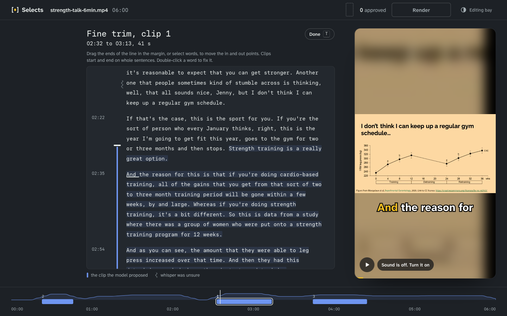
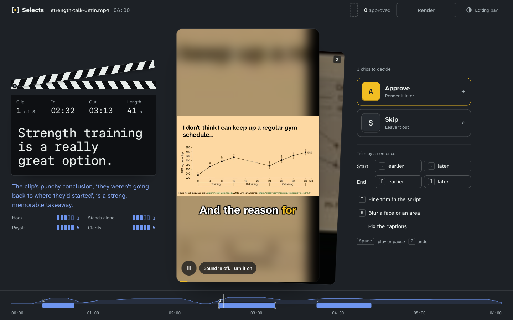
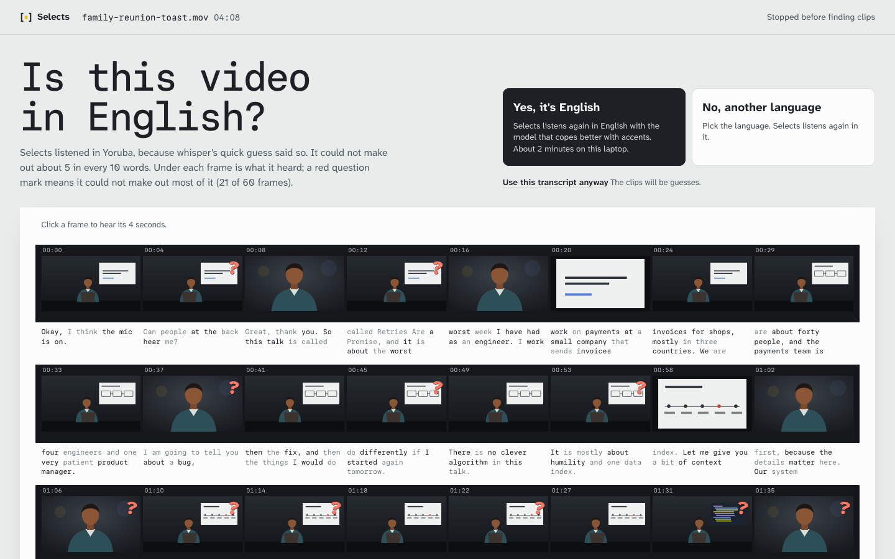

# Selects: three design directions

**Built, Fri 16 Oct.** Arnold chose the reel, with the lined script as its trim view. It is now the review screen of the app (`web/src/components/reel/`), wired to the real API, and the other screens use the same slate, script page and strip. The prototype code under `web/src/directions/` was removed, so the `?direction=` links below no longer work; the screenshots in `notes/screens/directions/` stay as the record of the three options. The built screens are in `notes/screens/v2/`.

Draft, Fri 16 Oct 2026. For Arnold to pick one before the current UI is replaced. Nothing in the current app changed except a four-line switch in `web/src/main.jsx` that loads a direction when the URL asks for one.

## How to open them

Run the core server and the web dev server (`node bin/selects.mjs serve`, then `npm run dev` in `web/`), and add a `direction` to the URL:

| URL | What it shows |
|---|---|
| `/?direction=lined-script` | Review, on the real job `j_20261016_07m4` (strength-talk-6min.mp4: real words, thumbnails, source video and the model's 3 picks) |
| `/?direction=reel` | Review, same job |
| `/?direction=contact-sheet` | Review, same job |
| add `&mock=1&job=j_20261016_unr2` | The language question, on the mock job whisper got wrong (toast-speech.mov, heard as Yoruba, 42% of words unsure). No real job in `.selects/jobs` has this state. |
| add `&theme=dark` or `&theme=light` | Force a theme (the reel is dark unless asked) |
| add `&approved=c_0014&skipped=c_0020` | Start with some decisions made (used for the screenshots) |

A switcher in the bottom right moves between the three and the current app (`&bar=0` hides it). The prototypes keep every decision in the tab: they never write to `job.json`, never start a render, and the language answers do not start whisper. Clip statuses start fresh ("proposed") so the review task is visible; the real job had all three approved.

Code: `web/src/directions/` (`shared/` holds the data hook, the window player and the language question; each direction has its own folder, component and CSS).

## Critique of the current UI

The palette and type are not the generic AI look: cool light table, semantic blue and yellow, Paper Mono timecode. The problem is the one you named: the light table lives in the skin (sprocket holes, colours, mono labels) while the interaction is forms and panels. I agree with that diagnosis and would add one thing. **The current UI asks the person to read numbers to make decisions they could make by eye or ear.** Every direction below replaces a number with something to look at or listen to.

Priority issues, in order:

1. **The language screen asks one question with five controls.** In the stopped state there is "It's English", "Keep Yoruba", "Transcribe again with small.en, in English", a form with two default grey selects and its own "Transcribe again", and "Find clips in it anyway". The words are the pipeline's ("mean confidence 0.63", "small.en", "Speech model"), and a progress bar at 99% sits under a job that has stopped. The person only needs to answer whether the video is in English.
2. **Half the transcript is dot-underlined.** When 46% of words are unsure, marking each one turns the text into noise and hides where the bad stretches are.
3. **Review has three focal points that compete:** the filmstrip, the small 9:16 preview and a detail panel that leads with "Model 0.57, Pre-score 0.54, Final round 1 of 4, Ranked by 0.63". Those are ranking internals in the primary view. The clip itself, the thing a clipper judges, is 200 px wide.
4. **The footer teaches seven shortcuts as a legend** instead of the one or two that matter, shown where they act.
5. **Nothing is memorable.** No moment in the flow would make a judge remember it a minute later.

Note, 17 Oct: the review screenshots of these directions showed clip 1 of the EMF talk, whose slide carries a figure under CC BY-NC-ND, so they were removed. The pictures below are of the built app, from clips 2 and 3.

## Direction 1: the lined script

**The idea.** A script supervisor marks coverage by drawing vertical lines through the script, one per setup. Here the transcript is the working surface, set like a screenplay page in Paper Mono: the model's clips are blue lines in the margin, yours turn grease-pencil yellow, skipped ones become dashed red, and you make or trim a clip by selecting words.

**Why it fits clippers.** A clipper's real question is "where does this thought start and end", and that is a question about words, not frames. Selecting a sentence is faster and more exact than dragging a handle on a 6-minute strip, and trims snap to whole sentences, so a clip never starts mid-word. The text also stays useful when the laptop is too busy to play video smoothly. The unsure stretches become one wavy line in the margin (in film, a wavy line means "off camera"), instead of underlining every word.

**The language question.** "Is this video in English?" in large type, with two answers that each say what happens next ("Yes, it's English: Selects listens again in English with the model that copes better with accents. About 2 minutes on this laptop." and "No, another language"). Below it, "Listen to 10 seconds from 02:55" plays the worst stretch. The page beside it shows what whisper wrote, with the wavy margin line. The numbers sit behind a "The numbers" link. "No" turns into a short list (Yoruba marked as whisper's guess, Igbo, Hausa, French, then any other language).

**The motion moment.** Approving inks the line: the yellow draws down over the blue in 460 ms. Nothing else moves.

**Risks.**
- Judging a clip's pull is mostly watching, and here the video is a 196 px docked monitor. People may not trust a pick they have only read.
- A 3-hour talk is about 30,000 words on one page. The prototype renders every word; production needs virtualised paragraphs (`content-visibility` broke headless screenshots and the margin measurements, so it is off for now).
- Paper Mono for long reading is a personality choice that costs some legibility compared with Atkinson Hyperlegible.
- Selecting text is fiddly on a phone.

**Screens.**
- `notes/screens/directions/lined-script-language-light.png`
- `notes/screens/directions/lined-script-language-dark.png`
- `notes/screens/directions/lined-script-language-no.png` (after "No")

## Direction 2: the reel

**The idea.** One clip at a time, playing large at 9:16 the way it will be posted, with the captions the render will burn in and the same fit or crop the render chose. Beside it is the slate (clap sticks, clip, in, out, length, the opening line set large, and the model's reason in blue). You decide with one key or a swipe, like culling photos: right or A approves, left or S skips, comma and full stop move the start by a sentence, the square brackets move the end, Z undoes.

**Why it fits clippers.** This is the actual job: watch, decide, next. A clipper reviewing ten picks wants ten fast decisions, not a dashboard. Only one video decodes at a time, which a 2017 dual-core can manage while whisper runs. The preview is honest about the output: caption chunks of 2 to 4 words with the current word in yellow, and the blurred-background fit drawn from one still image rather than a second video. The cards behind the current one show how many are left, and a thin strip along the bottom shows where each clip sits in the video and what you decided.

**The language question.** The card plays ten seconds of the worst stretch with whisper's own captions, unsure words in grey. Next to it: "Is this video in English?" and "Watch ten seconds with whisper's captions. If the words do not match what you hear, the answer is probably no." Two keycaps answer it: Y for "Yes, it's English", N for "No". After N, the keys become 1 to 4 for the likely languages plus a list for any other. This is the strongest evidence of the three, because a clipper can tell in three seconds by ear whether the captions are wrong.

**The motion moment.** A decided clip is thrown off the deck (right with an "Approved" stamp, left with "Skipped") in 320 ms, and the next clip is already playing underneath, so a keyboard user never waits for the animation. Swipes follow the finger 1:1, lean an "Approve" or "Skip" label in as you drag, and commit on distance or on a quick flick. With reduced motion, the throw is skipped.

**Risks.**
- You only see what the model proposed. If it missed the best moment, the strip shows where the picks are but gives no easy way to make a clip from scratch. It needs a "make a clip here" path (the lined script's word selection would do).
- Trimming by whole sentences is coarse for a 20-second clip.
- The card deck is a familiar pattern from dating apps; the slate and the film vocabulary have to carry the identity so it does not read as a gimmick.
- Browsers block sound until the first click, so the first clip plays muted with a "Sound is off" button.

**Screens.**
- `notes/screens/directions/reel-review-done.png` (all three decided: "2 clips to render.")
- `notes/screens/directions/reel-language-dark.png`
- `notes/screens/directions/reel-language-light.png`
- `notes/screens/directions/reel-language-no.png` (after N)

## Direction 3: the contact sheet (from the picture desk)

**The idea.** Before digital, a photo editor saw a whole roll at once as a contact sheet of small prints, read it through a loupe, and marked it with a china marker. Here the whole video is one sheet made from the stills Selects already extracts; the model's picks are drawn on it as blue loops, the clips you circle turn yellow, and the ones you cross out get a red X. A loupe follows the pointer and shows the frame bigger with the words spoken at that moment.

**Why it fits clippers on old laptops.** Nothing plays until you ask. The sheet is 58 small JPEGs that already exist, so there is no video decoding while whisper or the judge is using the CPU, which is exactly when a clipper on a 2017 dual-core is waiting. It shows the whole video at once, so you can see where the model looked and where it did not, and start a clip of your own by clicking two frames. Arrow keys move a focus frame and the loupe follows it, so it works without a mouse.

**The language question.** The same plain question and two answers across the top. The sheet below becomes the evidence: under each frame is what whisper heard during it, unsure words faded, and a red question mark on the frames where it could not make out most of the words ("21 of 60 frames"). Clicking a frame plays its few seconds.

**The motion moment.** The loupe: it trails the pointer slightly, like a glass moved over a print, and reads out the timecode and words under it. With reduced motion it moves without the trail.

**Risks.**
- This is the biggest one: **talks and podcasts look the same in every frame.** On a talking-head video the sheet is 58 copies of one person, and the stills carry almost no information. The slides in the strength talk make it look better than most real uploads will.
- Thumbnails are one per 6 seconds on this video and one per 31 seconds on a 31-minute one, so the sheet is coarse exactly where clips are short.
- The 192 x 108 thumbnails are soft under the loupe; sharper stills would mean more extraction work up front.
- The marks need careful colour work: blue loops sit on black film, so they use the lighter blue.

**Screens.**
- `notes/screens/directions/contact-sheet-language-light.png`
- `notes/screens/directions/contact-sheet-language-dark.png`
- `notes/screens/directions/contact-sheet-language-phone.png`

## What all three share

- One plain question for the language decision, two answers that say what happens next, the evidence in place, and the numbers out of the way. "Use this transcript anyway" stays as a quiet link, because it is a real choice, but it is no longer one of five buttons.
- Model blue, grease-pencil yellow, cut red: colour still means who made the mark, and it now marks something you act on.
- Bundled fonts only, no WebGL and no live blur. The one blur (the reel's fit backdrop) is painted once on a still image.
- Visible focus, keyboard paths for every action, reduced motion respected, and phone layouts (all three have a phone screenshot).

## Recommendation

**Build the reel, and borrow the lined script for trimming.**

The reel is the only direction where the main surface is the thing a clipper is judging: the clip, at the size and shape it will be posted, with the captions it will carry. The job in DESIGN.md is "review the AI's proposed clips fast, understand why each was picked, adjust, approve", and the reel does those four in that order on one screen, with one key each. It is also the best 60 to 90 seconds of demo: a judge sees a vertical clip playing, a reason in blue, a key press, and the next clip, and understands the product without narration. Its language screen is the most honest of the three, because it turns "mean confidence 0.63" into "watch this and tell me if the captions match".

Its weakness is adjustment: sentence nudges are coarse and there is no way to make a clip the model missed. The lined script solves exactly that, so it should be the reel's trim view (press T or click the slate's opening line to see the clip's words with its coverage line, and select words to change it), not a separate product. The contact sheet is the most original, but it fails on the most common input, a talking head, so I would not build it.

What I would do before Monday: port the reel's review and language screens onto the existing `Review` state and the real PATCH and `/language` calls (the prototypes already use the same job shape), keep the current filmstrip screen reachable as the detailed view, and add the lined-script trim view only if there is time left after the demo recording.
